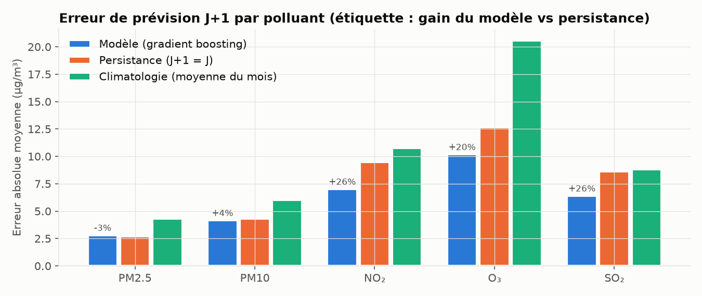
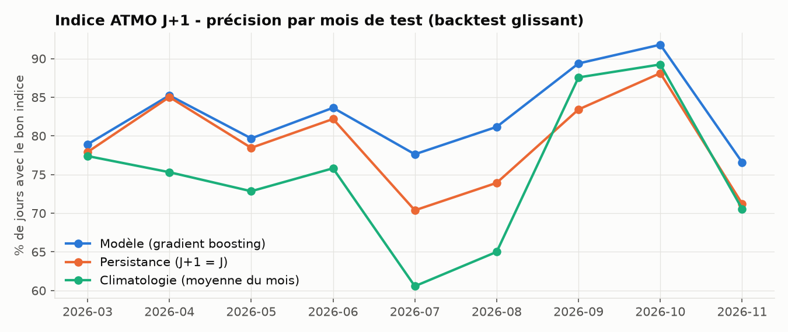
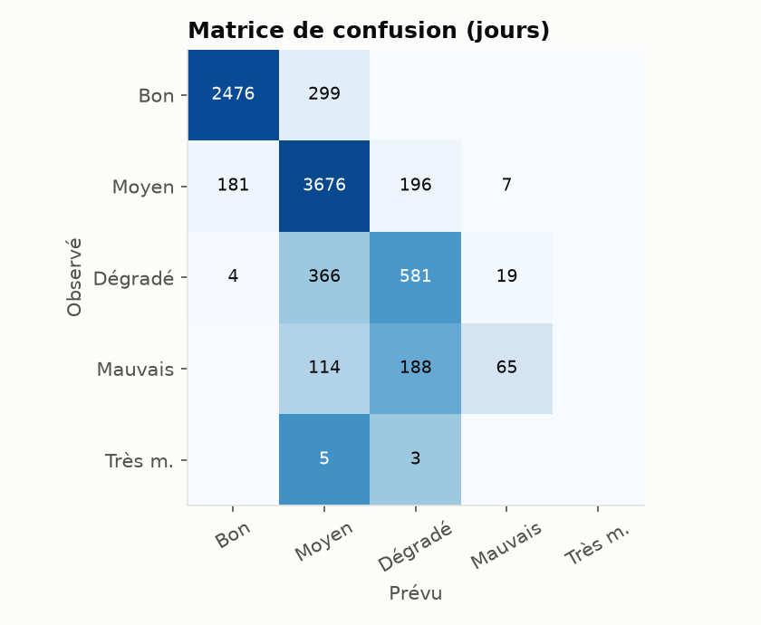
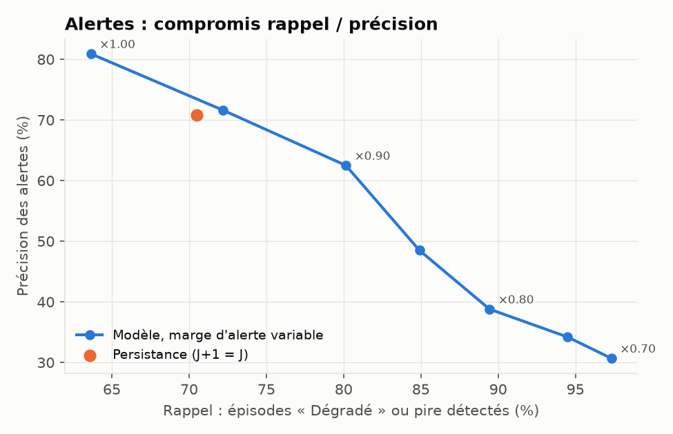
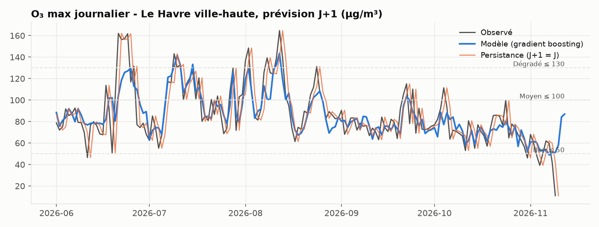
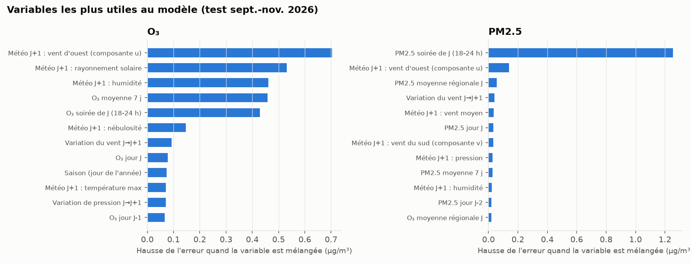

# Rapport — Module 3 : prévision de l'indice ATMO à 24 h

**Projet Aeria** — plateforme ouverte de surveillance de la qualité de l'air
Auteur : BRINIS Aya — novembre 2026
Dépôt : <https://github.com/brinis-aya/aeria-forecast>

---

## 1. Objectif

Prévoir, chaque soir, **l'indice ATMO du lendemain** pour chaque station de mesure de Normandie, avec
des métriques claires et un service web qui délivre la prévision. C'est le produit que publient les
associations agréées (ATMO Normandie) : « demain, qualité de l'air dégradée au Havre, cause ozone ».

Contraintes que je me suis fixées :

- **données réelles** uniquement (les capteurs simulés du module 1 ne suivent pas la météo réelle, voir
  le rapport du module 2) ;
- **aucune fuite d'information** : le modèle ne voit que ce qui est connu au moment de la prévision ;
- comparaison systématique à des **références simples**, sans quoi un score ne veut rien dire.

## 2. Formulation du problème

À la date d'émission J (le soir), prévoir pour J+1 les agrégats de l'indice ATMO :

| Polluant | Agrégat journalier (règle ATMO) |
|---|---|
| PM2.5, PM10 | moyenne journalière |
| NO₂, O₃, SO₂ | maximum des moyennes horaires |

Plutôt que de classer directement l'indice (6 classes très déséquilibrées : 0,1 % de « Très mauvais »),
le modèle **prévoit les concentrations** puis applique la grille officielle : sous-indice par polluant,
le pire l'emporte. Avantages :

- erreurs interprétables en µg/m³ ;
- un seul modèle sert toutes les stations, quels que soient les polluants qu'elles mesurent ;
- le polluant responsable est fourni, comme dans les bulletins officiels.

L'indice d'une station n'utilise que les polluants qu'elle mesure (au moins 50 % des jours), comme dans
l'entrepôt du module 2 ; prévision et observation sont donc toujours comparées sur la même base.

## 3. Données

| Source | Contenu | Volume |
|---|---|---|
| Entrepôt Aeria (module 2) | mesures horaires validées des 36 stations de référence, nov. 2025 → nov. 2026 | 803 871 valeurs → 34 039 jours-station-polluant |
| Open-Meteo Previous Runs API | prévisions météo **émises la veille** pour 8 points de Normandie | 3 008 jours-points |

**Le point méthodologique clé** est la météo. Utiliser la météo *observée* du lendemain donnerait des
scores flatteurs, inatteignables en production (on ne connaît pas encore le temps de demain). L'API
« Previous Runs » d'Open-Meteo conserve, pour chaque heure, la valeur prévue par le run de la veille
(`*_previous_day1`) : ce sont de vraies prévisions à 24-47 h. Le backtest utilise donc exactement
l'information dont le service aurait disposé.

Chaque station est rattachée au point météo le plus proche (Le Havre, Rouen, Caen, Cherbourg, Alençon,
Évreux, Dieppe, Saint-Lô). Le jeu de données est versionné dans `data/` (500 Ko) pour que le modèle soit
réentraînable sans l'entrepôt.

## 4. Variables (52)

| Groupe | Variables | Idée |
|---|---|---|
| Persistance | agrégat de J, J-1, J-2, moyenne 7 jours, pour chaque polluant | la pollution a de l'inertie |
| Niveau de soirée | moyenne 18 h-24 h de J | le signal le plus récent à l'heure d'émission |
| Fond régional | moyenne de toutes les stations normandes à J | épisodes de grande échelle, stations avec trous |
| Météo prévue J+1 | température (moy./min/max), humidité, vent (vitesse, composantes ouest-est et sud-nord), pluie, pression, rayonnement, nébulosité | dispersion, photochimie de l'ozone, lessivage |
| Évolution J → J+1 | variation de pression, température, vent | changements de masse d'air |
| Calendrier J+1 | jour de semaine, week-end/férié, saison (sin/cos) | trafic, cycle annuel |
| Station | type d'influence (fond / trafic / industrielle), type de zone | niveaux de base différents |

Le vent est décomposé en composantes `u` et `v` : une direction de 350° et une de 10° sont proches, ce
qu'un angle brut ne traduit pas.

## 5. Modèle

Cinq `HistGradientBoostingRegressor` (scikit-learn 1.9), un par polluant :

- gère nativement les **valeurs manquantes** (stations qui ne mesurent pas tout, jours de panne) ;
- capte les **non-linéarités** et interactions (soleil × vent faible → ozone) ;
- rapide : l'entraînement complet prend une quinzaine de secondes.

Hyperparamètres : 500 arbres, taux d'apprentissage 0,04, 31 feuilles max, 30 observations min par
feuille, régularisation L2 = 1. Volontairement prudents, sans recherche exhaustive, pour limiter le
sur-apprentissage sur un an de données.

**Choix de la cible.** Une première version entraînait tous les polluants sur `log(1 + concentration)`.
Résultat : des prévisions biaisées vers le bas (−3,7 µg/m³ sur l'ozone) et seulement 51 % des épisodes
détectés. Sans transformation, l'ozone et les particules sont mieux prévus ; le NO₂ et le SO₂, très
asymétriques, restent meilleurs en log. Le modèle final mélange donc les deux.

| Variante | Indice exact | F1 alertes | MAE O₃ | MAE NO₂ |
|---|---|---|---|---|
| tout en log | 82,1 % | 0,64 | 10,6 | 7,0 |
| tout en brut | 83,0 % | 0,71 | 10,2 | 7,6 |
| **mixte (retenu)** | **83,1 %** | **0,71** | **10,2** | **7,0** |

*Limite honnête : ce choix a été fait sur le même backtest que celui des résultats. L'effet sur les
scores est faible (un point), mais un jeu de validation séparé serait plus rigoureux avec plus de données.*

## 6. Évaluation

### 6.1 Protocole : backtest glissant

Un découpage aléatoire mélangerait passé et futur. On utilise une **origine glissante** : pour chaque mois
de test de mars à novembre 2026, un modèle est entraîné sur toutes les dates antérieures (de
novembre 2025 à la veille du mois), puis prévoit chaque jour du mois. 9 modèles au total, 8 180
jours-stations évalués, toutes saisons sauf l'hiver (qui sert à l'entraînement initial).

Deux références :

- **persistance** : demain = aujourd'hui. Très difficile à battre à 24 h pour des polluants à inertie ;
- **climatologie** : moyenne de la station pour le même mois dans les données d'entraînement.

### 6.2 Concentrations

| MAE (µg/m³) | PM2.5 | PM10 | NO₂ | O₃ | SO₂ |
|---|---|---|---|---|---|
| Modèle | 2,80 | 4,16 | 7,01 | 10,18 | 6,40 |
| Persistance | 2,72 | 4,31 | 9,48 | 12,67 | 8,62 |
| Climatologie | 4,30 | 6,02 | 10,76 | 20,59 | 8,82 |
| R² modèle | 0,46 | 0,51 | 0,61 | 0,67 | 0,20 |

- **NO₂, O₃, SO₂ : −20 à −26 % d'erreur** par rapport à la persistance. Ce sont les polluants dont le
  niveau dépend surtout de la météo du jour (dispersion, ensoleillement).
- **Particules : pas de gain** (−3 % et +4 %). Le niveau de la veille au soir explique déjà presque tout.
- Le SO₂ reste mal prévu (R² 0,20) : ses pics sont des rejets industriels ponctuels, imprévisibles
  sans données d'activité des sites.

### 6.3 Indice ATMO

| | Modèle | Persistance | Climatologie |
|---|---|---|---|
| Indice exact | **83,1 %** | 79,6 % | 75,2 % |
| À un niveau près | 98,4 % | 98,7 % | 95,2 % |
| F1 macro (6 classes) | 0,53 | 0,54 | 0,33 |

Le modèle est meilleur que la persistance **tous les mois**, avec l'écart le plus net en juillet-août
(+7 points) : c'est la saison de l'ozone, polluant responsable de l'indice une majorité de jours, et le
plus dépendant de la météo. Au printemps, les épisodes de particules dominent et le gain est faible.

La matrice de confusion montre le défaut principal : le modèle **sous-estime les jours pollués**
(366 jours « Dégradé » prévus « Moyen », aucun « Très mauvais » prévu). C'est l'effet classique d'une
régression, qui tire vers la moyenne, surtout pour des épisodes rares.

### 6.4 Alertes « Dégradé ou pire »

Pour un service public, l'enjeu est de prévenir les épisodes (indice ≥ 3, 16 % des jours).

| | Rappel | Précision | Fausses alertes |
|---|---|---|---|
| Modèle, marge 1,00 | 64 % | 81 % | 203 |
| **Modèle, marge 0,95 (défaut API)** | **72 %** | **72 %** | 376 |
| Modèle, marge 0,90 | 80 % | 63 % | 638 |
| Persistance | 70 % | 71 % | 389 |

La **marge d'alerte** déclenche l'alerte quand une concentration prévue atteint `marge ×` le seuil
« Dégradé ». C'est un réglage de politique publique, pas un paramètre du modèle : vaut-il mieux une
fausse alerte ou un épisode manqué ? Le service expose ce paramètre ; la valeur par défaut 0,95 équilibre
rappel et précision, un peu au-dessus de la persistance sur les deux critères.

### 6.5 Focus Le Havre

Quatre stations ont un indice complet au Havre et autour (Lafaurie, ville-haute, Herriot, Gonfreville),
soit 790 jours évalués.

| | Modèle | Persistance |
|---|---|---|
| Indice exact | **76,6 %** | 74,3 % |
| F1 alertes (marge 1,00) | 0,55 | **0,68** |
| Rappel / précision alertes (marge 0,95) | 54 % / 63 % | 68 % / 68 % |

Au Havre, le modèle prévoit mieux l'indice mais **détecte moins bien les épisodes que la persistance**.
L'explication se lit dans la cause des épisodes : au Havre, les PM2.5 sont responsables de **35 %** des
129 jours « Dégradé ou pire », contre 13 % sur l'ensemble de la Normandie (l'ozone fait le reste ; le SO₂
industriel n'est jamais en cause dans l'indice). Or les particules sont justement le polluant où le
modèle n'apporte rien par rapport à la persistance. C'est la limite principale du travail.

Sur l'ozone en revanche, la série montre l'intérêt de la météo. La persistance « suit avec un jour de
retard » (décalage visible à chaque pic) ; le modèle anticipe la montée des épisodes de juin à août, en
sous-estimant toutefois les maxima.

### 6.6 Ce que le modèle a appris

Importance par permutation (hausse de l'erreur quand on mélange une variable), modèle entraîné jusqu'à
fin août et testé sur septembre-novembre :

- **Ozone** : le vent d'ouest prévu en tête (air océanique propre et dispersion), puis le rayonnement
  solaire et l'humidité (photochimie), et le niveau des jours précédents. Cohérent avec la physique de
  l'ozone.
- **PM2.5** : le niveau de la soirée de J domine très largement, suivi du vent d'ouest. Confirme que les
  particules relèvent surtout de la persistance à cet horizon.

## 7. Service FastAPI

| Endpoint | Rôle |
|---|---|
| `GET /forecast` | indice de demain pour toutes les stations |
| `GET /forecast/{station}` | une station (ex. `FR05090`) |
| `GET /stations` | stations et polluants de leur indice |
| `GET /model` | fiche du modèle : version, période d'entraînement, métriques du backtest |
| `GET /health` | supervision |

Paramètres : `issue_date` (rejouer une date passée) et `alert_margin`. Deux sources de données :

- **entrepôt** (`DW_URL` défini) : neuf derniers jours de mesures, plus la prévision Open-Meteo courante
  pour demain. C'est le fonctionnement en production ;
- **jeu de données versionné** : démonstration hors ligne et tests.

Pour une date passée, la météo utilisée est celle prévue à l'époque (Previous Runs API) : une prévision
rejouée est celle que le service aurait donnée ce jour-là. Les résultats sont mis en cache une heure
(un appel froid prend environ 6 s, surtout pour la météo).

Exemple réel : émise le 12 août 2026 pour le 13 août au Havre ville-haute, la prévision donne
« Mauvais, cause ozone, 166 µg/m³ » ; 165 µg/m³ ont été mesurés. Note : ce rejeu passe par le modèle
final, qui a vu cette date à l'entraînement. Le backtest reste la mesure honnête de la qualité.

Livraison : image Docker non-root avec healthcheck. Le modèle (3,9 Mo, joblib) est versionné avec les
versions exactes des bibliothèques (`requirements.txt`), car un fichier pickle scikit-learn n'est
fiable qu'avec la version qui l'a produit. Un test le vérifie.

## 8. Tests et intégration continue

25 tests pytest, sans réseau ni base de données :

- agrégats journaliers (moyenne / max, soirée, règle des 18 h, jour local), composantes du vent, unités ;
- **absence de fuite** : on modifie toutes les données postérieures à J, les variables de J doivent
  rester identiques ; la météo utilisée est bien celle de J+1 ;
- **backtest** : aucun modèle n'est entraîné sur une date dont la cible tombe dans son mois de test ;
- le modèle apprend un signal synthétique (ozone lié au rayonnement) et bat la persistance ;
- indice calculé uniquement sur les polluants de la station ;
- API : endpoints, erreurs 404/422, effet monotone de la marge d'alerte, et **cohérence entre le service
  et l'entraînement** (mêmes variables, même prévision).

GitHub Actions : tests, réentraînement de contrôle à partir du jeu versionné, construction de l'image
Docker, puis appel réel de l'API dans le conteneur.

## 9. Limites et pistes

- **Un an de données** : l'hiver n'est jamais en test, et les épisodes « Mauvais » sont rares
  (367 jours-stations). Deux ou trois ans amélioreraient surtout la détection des épisodes.
- **Particules et industrie** : ajouter les prévisions de modèles de chimie-transport (CAMS, Copernicus),
  qui anticipent les épisodes de particules secondaires et les panaches, est la piste la plus prometteuse.
- **Régression vers la moyenne** : une régression par quantiles (prévoir le 75ᵉ centile) ou un
  classifieur dédié aux épisodes donnerait de meilleures alertes.
- **Incertitude** : fournir un intervalle (quantiles 10-90 %) plutôt qu'une seule valeur.
- **Indice communal** : l'indice officiel est publié par commune, à partir de modèles de dispersion. Ici
  il est calculé par station.

## 10. Lien avec les autres modules

- **Module 2** : source des mesures (`dw.v_measurement`), mêmes règles d'agrégation et de seuils.
- **Module 6 (tableau de bord)** : la carte affichera l'indice prévu et le polluant responsable via
  `GET /forecast`.
- **Module 5 (sécurité)** : service sans état, conteneur non-root, base en lecture seule via `DW_URL`.
